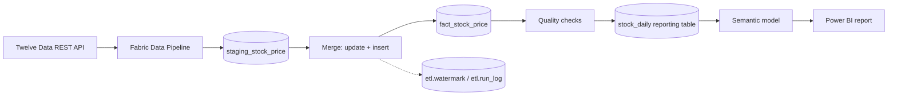

# Automated US Stock Data Pipeline on Microsoft Fabric

An end-to-end data engineering project: a scheduled pipeline pulls daily US stock prices from a REST API, loads them into a Microsoft Fabric Warehouse through a staging layer, validates them, and feeds a Power BI dashboard. It runs unattended every weekday evening.

**Source:** Twelve Data API | **Pipeline:** Fabric Data Pipeline | **Warehouse:** Fabric Warehouse (T-SQL) | **BI:** Power BI (Direct Lake semantic model)

---

## Architecture



Flow of one run: **Get_Symbols -> Clear_Staging -> ForEach_Symbol (Copy_Prices) -> Merge_To_Fact -> Quality_Checks -> Refresh_Report_Table -> Refresh_Dashboard**

## What it does

- Loads daily open, high, low, close and volume for **25 US stocks across 5 sectors** (Technology, Financials, Energy, Healthcare, Consumer), history from 2020-01-02.
- Runs **Monday to Friday at 6:00 PM New York time**, after the US market closes.
- Loads **incrementally**: each run fetches only the last few days per stock, based on a watermark.
- Stops the pipeline before the dashboard refresh if a data quality check fails.

## Data model

| Table | Purpose |
|---|---|
| `dbo.dim_symbol` | Stocks to load (symbol, exchange, company, sector, `is_active`). The pipeline reads its work list from here |
| `dbo.staging_stock_price` | Raw API rows as text. Emptied at the start of every run |
| `dbo.fact_stock_price` | Clean, typed, permanent price history. Key: symbol + exchange + trade_date |
| `etl.watermark` | Last loaded date per stock |
| `etl.run_log` | One audit line per step per run (SUCCESS / WARNING / FAILED) |
| `dbo.stock_daily` | Reporting table for Power BI: adds company, sector, daily % change, 7-day and 30-day moving averages |

## Pipeline activities

| Activity | What it does |
|---|---|
| `Get_Symbols` (Lookup) | Runs `etl.sp_get_symbols_to_load`. Returns each active stock with a start date (watermark minus 5 days, or 2020-01-01 for new stocks) |
| `Clear_Staging` (Script) | `TRUNCATE` the staging table |
| `ForEach_Symbol` | Loops over the stock list, **sequentially**, to respect the API rate limit |
| `Copy_Prices` (Copy) | REST source: `/time_series?symbol=...&exchange=...&interval=1day&start_date=...&outputsize=5000&order=asc`. Collection reference `values`; adds `symbol`, `exchange` and `run_id` as extra columns. Appends to staging. Retry 2, timeout 10 min |
| `Merge_To_Fact` | `etl.sp_merge_stock_price`: idempotent upsert, moves the watermark, logs the row count |
| `Quality_Checks` | `etl.sp_quality_checks`: duplicates, impossible prices, null or non-positive close, stale data |
| `Refresh_Report_Table` | `etl.sp_refresh_stock_daily`: rebuilds the reporting table |
| `Refresh_Dashboard` | Semantic model refresh, only if everything before it succeeded |
| `Log_*_Failed` (Script) | On each failure path, writes a `FAILED` line to `etl.run_log` |

The API key is stored in a pipeline parameter and is **not** part of this repository.

## Key design decisions

- **Staging layer:** raw data lands in staging first, so a failed run can never corrupt the permanent table.
- **Idempotent upsert:** the merge updates existing rows and inserts new ones. Rerunning, or re-fetching the overlap window, never creates duplicates. (Fabric Warehouse does not enforce primary keys, so this logic and the quality checks are what protect integrity.)
- **Overlap window:** every run re-fetches the last 5 days. A mid-day manual run stored a provisional price for the day, and the scheduled run after the close replaced it with the final close automatically.
- **Metadata-driven:** adding or pausing a stock means editing one row in `dim_symbol`. The pipeline does not change.
- **Reporting table instead of a view:** a view in a Direct Lake semantic model forces a DirectQuery fallback, so the pipeline rebuilds a real table (`stock_daily`) after the quality checks pass.
- **Failure logging:** each failure path writes to an audit table, so failures are queryable as well as visible in Monitor.

## Challenges and lessons

| Problem | What happened | Resolution |
|---|---|---|
| Indian stocks | The API returned a plan restriction error for NSE symbols on the free plan | Switched to US stocks, which the free plan includes |
| Merge loaded 0 rows | The `run_id` parameter was entered as plain text instead of dynamic content | Re-entered it as `@pipeline().RunId` |
| 401 on schema import | The key did not reach the request from a secure parameter | Used a string parameter during setup, rotated the key afterwards |
| Parallel loop failed | Running 3 copies at once exceeded the free plan's 8 requests per minute (HTTP 429) | Went back to sequential execution with retries. The failure path logged the error and the fact table stayed untouched |
| Direct Lake fallback warning | The semantic model read a T-SQL view | Replaced it with a pipeline-maintained reporting table |

## Dashboard

Add your screenshots to `docs/images/` and update the paths below.


## Repository structure

```
.
├── README.md
├── sql/
│   ├── 01_schema_and_tables.sql
│   ├── 02_stored_procedures.sql
│   ├── 03_seed_symbols.sql
│   └── 04_monitoring_queries.sql
└── docs/images/
```

## How to reproduce

1. Create a Twelve Data account and API key (free plan covers US stocks: 800 requests a day, 8 per minute).
2. In Microsoft Fabric, create a workspace and a Warehouse.
3. Run `sql/01` to `sql/03` in the Warehouse SQL editor. Run each `CREATE PROCEDURE` in `02` as its own batch.
4. Create a Data Pipeline with the activities above. Store the API key in a pipeline parameter and build the Copy URL from it.
5. Create a semantic model on `dbo.stock_daily`, build the report, and add a weekday schedule (6 PM Eastern).

## Limitations and next steps

- A sequential run of 25 stocks takes about 17 minutes. Most of that is fixed per-Copy startup time, not data volume.
- US stocks only, because the free plan does not include Indian exchanges.
- No email alerts. Failures are logged and visible in Monitor.
- Next: a single notebook-based extractor with a built-in rate limiter, a raw landing layer, and a pipeline health page in the report.

## Security note

No API keys, tokens or exported pipeline definitions are stored in this repository. Rotate any key that has ever appeared in a screenshot or an export.
